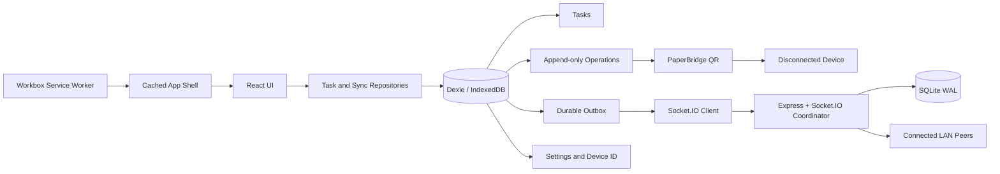
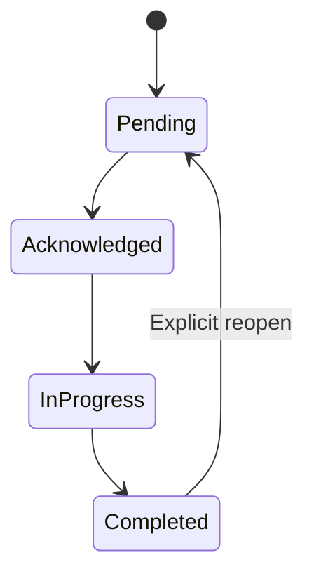
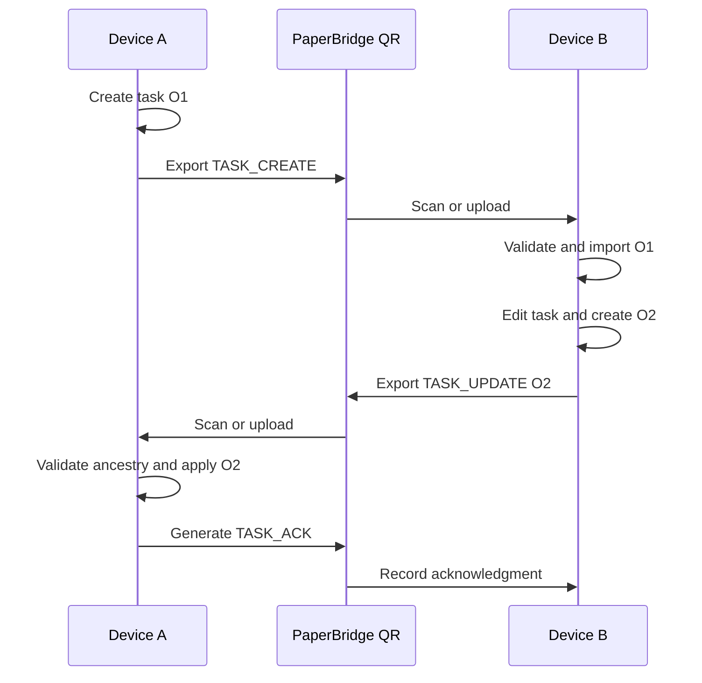
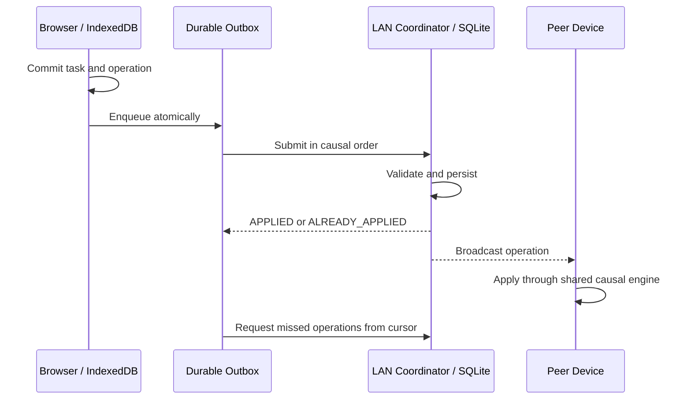

# Relay Miden

> **When networks fail, communication shouldn't.**

Relay Miden is an offline-first, multilingual task-coordination platform built for the **Works Anyway** track at **Devin Hacks Kochi**. It helps communities create, exchange, update, and reconcile operational tasks when public internet access is unavailable, devices do not share a network, or participants do not share a language.

The project uses local browser storage, optical QR transfer, and an optional local Wi-Fi coordinator. It requires no paid API, cloud database, user account, or internet connection for its core task workflows.

## Release status


| Area                                                                                         | Status                 | Evidence                                                                               |
| -------------------------------------------------------------------------------------------- | ---------------------- | -------------------------------------------------------------------------------------- |
| Local task creation, editing, status changes, search, filters, sorting, and soft deletion    | Verified               | Vitest repository tests and Playwright browser flows                                   |
| IndexedDB persistence and anonymous device identity                                          | Verified               | Database reopen, migration, refresh, and browser persistence tests                     |
| English, Malayalam, and Tamil structured task rendering                                      | Verified               | Dictionary, persistence, QR, and browser language tests                                |
| PaperBridge `TASK_CREATE`, `TASK_UPDATE`, and `TASK_ACK`                                     | Verified               | Two isolated browser contexts, duplicate, ancestry, conflict, and acknowledgment tests |
| LAN synchronization, SQLite persistence, durable outbox, replay, and manual Sync             | Verified in automation | Client/server Socket.IO integration and recovery tests                                 |
| PWA manifest, app-shell caching, offline navigation, installation controls, and safe updates | Verified in automation | Manifest, Workbox, storage-safety, and offline browser tests                           |
| Responsive UI                                                                                | Verified               | 320, 375, 390, 430, 768, 1024, and 1440 px browser coverage                            |
| Physical phone camera, certificate trust, venue firewall, and two-device Wi-Fi               | Requires rehearsal     | Hardware and local-network conditions cannot be proven by desktop automation           |

Latest verification:

- **135/135 Vitest tests passed** across 11 test files.
- **22/22 Playwright tests passed**.
- Strict TypeScript, ESLint, Prettier, and all production builds passed.
- Workbox generated a service worker with **32 precached assets (1,421.13 KiB)**.
- Vite reports one non-blocking advisory: the primary minified JavaScript bundle exceeds 500 kB.

## The problem

Emergency coordination commonly assumes three things that may not exist during a disruption:

1. A working internet connection.
2. A shared network between devices.
3. A common language between participants.

Relay Miden separates task meaning from transport. Every task is stored locally first, represented through validated canonical data, and exchanged through whichever channel is available.

## Capability map

| Constraint                             | Relay Miden response                                                       | Network required?         |
| -------------------------------------- | -------------------------------------------------------------------------- | ------------------------- |
| Public internet unavailable            | Task engine runs entirely from IndexedDB                                   | No                        |
| Devices have no shared network         | PaperBridge transfers tasks and updates through QR                         | No                        |
| Devices share local Wi-Fi or a hotspot | Socket.IO synchronizes through a laptop-hosted coordinator                 | Local network only        |
| Participants use different languages   | Canonical structured instructions render in English, Malayalam, or Tamil   | No                        |
| A device temporarily disconnects       | Durable outbox stores operations and replays them after reconnect          | No while editing          |
| Browser or app is restarted offline    | PWA app shell starts from Workbox cache and task data loads from IndexedDB | No, after initial caching |

## Features

### Offline task management

- Create free-text or structured operational tasks.
- Edit title, action, quantity, unit, location, priority, and notes.
- Advance tasks through a controlled status lifecycle and explicitly reopen completed work.
- Soft-delete tasks without removing synchronization history.
- Search title, description, and location; filter by status and priority; sort by date or priority.
- Calculate dashboard statistics and recent activity reactively from IndexedDB.
- Persist an anonymous device UUID without accounts or authentication.
- Validate all saved records with shared Zod schemas.

### Multilingual structured communication

- Bundled English (`en`), Malayalam (`ml`), and Tamil (`ta`) dictionaries.
- Canonical action, item, and unit codes remain unchanged between languages.
- Structured instructions render in the selected local language immediately.
- Language preference persists locally across refreshes.
- Arbitrary locations and notes stay in the language entered by the user.

### PaperBridge QR synchronization

- Version 1 `TASK_CREATE` envelopes for transferring a task to a new device.
- Version 2 `TASK_UPDATE` envelopes for edits, status changes, deletions, and conflict resolutions.
- Version 2 `TASK_ACK` envelopes for returning an application receipt.
- Deterministic canonical JSON, SHA-256 integrity validation, and stable IDs on retry.
- QR generation, PNG download, payload copying, live camera scanning, image upload, and camera flipping.
- Client-side parsing and image decoding with no QR service or remote API.
- Duplicate detection, missing-parent handling, stale-update classification, and conflict preservation.
- A 2,048-byte payload ceiling to keep QR codes reliably scannable.

### LAN synchronization and recovery

- Local Express and Socket.IO coordinator with persistent SQLite storage.
- Configurable host, port, CORS origin, session token, and HTTPS certificates.
- Server acknowledgment only after durable SQLite acceptance.
- Real-time operation broadcast and incremental cursor-based catch-up.
- Durable IndexedDB outbox with `PENDING`, `IN_FLIGHT`, `ACKNOWLEDGED`, `BLOCKED`, and `FAILED` states.
- Automatic reconnection with bounded exponential backoff and jitter.
- Parent-first causal replay and idempotent lost-acknowledgment recovery.
- Manual **Connect & Sync** for explicit bidirectional reconciliation.
- Accurate connection, queue, error, and synchronization indicators.
- Shared operation semantics across QR and LAN transports.

### Progressive Web App

- Installable manifest with standard, high-resolution, maskable, Apple touch, and favicon assets.
- Workbox-generated app-shell precache and offline navigation fallback.
- API, health, and Socket.IO paths excluded from navigation caching.
- Chromium/Android install prompt support and iOS Add to Home Screen guidance.
- User-controlled service-worker updates without clearing IndexedDB.
- Secure HTTPS/WSS development workflow for mobile cameras and LAN synchronization.
- Explicit cache-error reporting when offline startup is unavailable.

### Responsive interface

- Forest-green desktop sidebar, mobile header, and dedicated mobile bottom navigation.
- Responsive dashboard, forms, task lists, details, QR screens, connections, and settings.
- Touch-friendly controls and keyboard-accessible form labels.
- Centralized palette with unfilled metric icons and plain-text priority/status indicators.

## Architecture



The browser database remains the primary source of truth for the current device. QR and LAN are transports for immutable operations; neither transport directly replaces local task records without validation.

### Transport-to-operation mapping

| User action              | Durable operation     | QR representation               | LAN representation                   |
| ------------------------ | --------------------- | ------------------------------- | ------------------------------------ |
| Create task              | `TASK_CREATE`         | PaperBridge v1 `TASK_CREATE`    | LAN `TASK_CREATE` payload            |
| Edit task                | `TASK_UPDATE`         | PaperBridge v2 `TASK_UPDATE`    | LAN `TASK_UPDATE` payload            |
| Advance or reopen status | `TASK_UPDATE`         | PaperBridge v2 `TASK_UPDATE`    | LAN `TASK_UPDATE` payload            |
| Soft-delete task         | `TASK_DELETE`         | PaperBridge v2 tombstone update | LAN causal update                    |
| Resolve conflict         | `TASK_RESOLVE`        | PaperBridge v2 resolution       | LAN causal resolution                |
| Import initial QR task   | `TASK_IMPORT` audit   | Receiver-side only              | Not republished as a local create    |
| Acknowledge QR update    | Acknowledgment record | PaperBridge v2 `TASK_ACK`       | Server acceptance is transport-level |

### Local data mapping

| IndexedDB table   | Purpose                         | Key behavior                         |
| ----------------- | ------------------------------- | ------------------------------------ |
| `tasks`           | Current materialized task state | Soft deletes remain stored           |
| `operations`      | Append-only mutation history    | Stable operation IDs and revisions   |
| `settings`        | Device ID and preferences       | Survives refresh and restart         |
| `imports`         | Received QR message ledger      | Prevents duplicate imports           |
| `outgoing`        | Generated QR updates            | Preserves message identity for retry |
| `acknowledgments` | QR receipts                     | Idempotent matching                  |
| `conflicts`       | Concurrent branches             | Retained until explicit resolution   |
| `outbox`          | Pending LAN delivery            | Replayed after reconnect             |

Server-side SQLite persists coordinator metadata, devices, task projections, append-only operations, and conflicts in WAL mode.

## Task and synchronization lifecycles

### Task status mapping



| Stored value   | UI label     | Meaning                                         |
| -------------- | ------------ | ----------------------------------------------- |
| `pending`      | Pending      | Created but not yet accepted                    |
| `acknowledged` | Acknowledged | A coordinator or field device accepted the task |
| `in_progress`  | In Progress  | Work has started                                |
| `completed`    | Completed    | Work finished                                   |

### PaperBridge round trip



### LAN replay and catch-up



## Language mapping

Structured instructions store language-neutral codes and render through local dictionaries.

| Canonical code | English | Malayalam              | Tamil      |
| -------------- | ------- | ---------------------- | ---------- |
| `DELIVER`      | Deliver | എത്തിക്കുക             | வழங்கவும்  |
| `WATER`        | Water   | വെള്ളം                 | தண்ணீர்    |
| `BOTTLE`       | Bottles | കുപ്പി                 | பாட்டில்   |
| `pending`      | Pending | തീർപ്പുകൽപ്പിക്കാത്തത് | நிலுவையில் |
| `urgent`       | Urgent  | അടിയന്തിരം             | அவசரம்     |

The canonical record, task ID, revisions, hashes, and synchronization history do not change when the display language changes.

## Route map

| Route          | Screen         | Main responsibility                                             |
| -------------- | -------------- | --------------------------------------------------------------- |
| `/`            | Dashboard      | Live statistics, recent tasks, connectivity, and quick creation |
| `/create`      | Create Task    | Full structured or free-text task form                          |
| `/tasks`       | Tasks          | Search, status/priority filters, sorting, and navigation        |
| `/tasks/:id`   | Task Details   | Timeline, editing, status, conflict resolution, and deletion    |
| `/send`        | Send via QR    | Task, update, or acknowledgment QR export                       |
| `/receive`     | Receive via QR | Camera/image decode, validation, preview, and import            |
| `/connections` | Connections    | LAN configuration, manual Sync, and outbox status               |
| `/settings`    | Settings       | Language, identity, PWA installation, cache, and updates        |

## Technology stack

| Layer              | Technology                                           |
| ------------------ | ---------------------------------------------------- |
| Frontend           | React 19, Vite 8, TypeScript 6, React Router 8       |
| Styling            | Tailwind CSS 4, CSS variables, DM Sans, Lucide React |
| Local persistence  | Dexie 4 and IndexedDB                                |
| Validation         | Zod shared schemas                                   |
| QR                 | `qrcode`, `html5-qrcode`, `jsQR`, SHA-256            |
| LAN                | Socket.IO Client, Express 5, Socket.IO               |
| Server persistence | Built-in `node:sqlite` with WAL mode                 |
| PWA                | `vite-plugin-pwa` and Workbox                        |
| Quality            | Vitest, fake-indexeddb, Playwright, ESLint, Prettier |
| Workspace          | npm workspaces                                       |

## Repository structure

```text
relay-miden/
├── apps/
│   ├── web/
│   │   ├── public/                 # PWA icons and static assets
│   │   └── src/
│   │       ├── components/         # Layout, dashboard, task, QR, PWA, and UI
│   │       ├── db/                 # Dexie schema and task repository
│   │       ├── hooks/              # Language, LAN, and PWA state
│   │       ├── i18n/               # English, Malayalam, and Tamil
│   │       ├── pages/              # Routed screens
│   │       ├── services/           # PaperBridge, causal sync, and LAN
│   │       └── styles/             # Central palette and global styles
│   └── server/src/                 # Express, Socket.IO, SQLite, and sync services
├── packages/shared/src/            # Zod schemas and transport-neutral types
├── docs/                            # Architecture, protocols, setup, and history
├── scripts/                         # Development, certificates, and icons
├── tests/                           # Playwright browser coverage
├── AGENTS.md
├── README.md
└── package.json
```

## Prerequisites

- Node.js `>=24 <25`
- npm `>=11`
- Chromium installed by Playwright for browser tests
- Optional: `mkcert` or OpenSSL for trusted LAN HTTPS certificates

```powershell
npm ci
npx playwright install chromium
```

## Running Relay Miden

### Single laptop

```powershell
npm run dev
```

- Web application: `http://127.0.0.1:5173`
- Health endpoint: `http://127.0.0.1:3001/health`

### Same-Wi-Fi laptop and phone over HTTP

```powershell
npm run dev:lan
```

- Phone URL: `http://<laptop-ip>:5173`
- LAN coordinator: `http://<laptop-ip>:3001`
- Camera and service-worker features may be restricted on an insecure LAN origin. QR image upload remains available.

### Secure laptop and phone demo

```powershell
npm run cert:gen
npm run dev:https
```

1. Run `ipconfig` and find the IPv4 address of the active Wi-Fi adapter.
2. Trust the generated local certificate authority on the phone.
3. Open `https://<laptop-ip>:5173` on the phone.
4. Verify `https://<laptop-ip>:3001/health` from the phone.
5. Enter `https://<laptop-ip>:3001` on both devices' Connections page.

`127.0.0.1` always refers to the current device and must not be entered on the phone. See [PWA and secure LAN setup](docs/pwa-offline-setup.md) and [physical synchronization testing](docs/synchronization-repair-testing.md).

## Environment variables

Copy `.env.example` to `.env` and adjust only what the demo needs.

| Variable            | Purpose                                   | Typical value                            |
| ------------------- | ----------------------------------------- | ---------------------------------------- |
| `HOST`              | Server bind interface                     | `127.0.0.1` locally or `0.0.0.0` for LAN |
| `PORT`              | Express/Socket.IO port                    | `3001`                                   |
| `DB_PATH`           | Persistent SQLite file                    | `apps/server/data/relay-miden.sqlite`    |
| `LAN_SESSION_TOKEN` | Optional shared LAN secret                | A local private value                    |
| `CORS_ORIGIN`       | Allowed browser origin(s)                 | Local app origin                         |
| `HTTPS`             | Enable generated development TLS settings | `true`                                   |
| `SSL_KEY_FILE`      | TLS private-key path                      | `certs/dev-key.pem`                      |
| `SSL_CRT_FILE`      | TLS certificate path                      | `certs/dev-cert.pem`                     |
| `VITE_API_URL`      | Reserved public frontend API base         | `http://127.0.0.1:3001`                  |

Never place credentials in a `VITE_` variable because Vite exposes them to the browser bundle. Generated keys and certificates are ignored by the repository configuration.

## Commands

| Command                                | Purpose                                     |
| -------------------------------------- | ------------------------------------------- |
| `npm run dev`                          | Start frontend and server locally           |
| `npm run dev:lan`                      | Bind services for LAN HTTP access           |
| `npm run cert:gen`                     | Generate a multi-IP development certificate |
| `npm run dev:https`                    | Start frontend and server over HTTPS/WSS    |
| `npm run typecheck`                    | Run strict TypeScript checks                |
| `npm run lint`                         | Run ESLint with zero-warning policy         |
| `npm test`                             | Run Vitest unit and integration tests       |
| `npm run test:e2e`                     | Run Playwright browser tests                |
| `npm run build`                        | Build shared, server, and web workspaces    |
| `npm run format:check`                 | Verify Prettier formatting                  |
| `npm run format`                       | Format the workspace                        |
| `npm run preview -w @relay-miden/web`  | Preview the production UI on port 4173      |
| `npm run start -w @relay-miden/server` | Start the compiled LAN server               |

## Two-minute judging demo

1. **Offline task engine — 30 seconds:** create an urgent structured task, open its details, advance its status, and refresh. Show that the task and operation timeline persist without a backend request.
2. **Multilingual rendering — 15 seconds:** switch to Malayalam or Tamil and reopen the task. Explain that canonical codes and synchronization identity remain stable.
3. **PaperBridge — 35 seconds:** transfer the task from Device A to Device B with **Send Task**. Edit it on B; the Send page automatically selects **Send Update**. Apply it on A and show the acknowledgment QR.
4. **LAN recovery — 25 seconds:** connect both devices, create or update a task, and show the peer update without refresh. Briefly disconnect one device, edit locally, reconnect, and show the outbox return to zero.
5. **Offline PWA — 15 seconds:** after **Ready offline** appears, disable network access and navigate between Dashboard, Tasks, and Task Details.

Keep a downloaded QR PNG ready. Image upload is the most reliable fallback if venue lighting, focus, or certificate configuration affects the live camera.

## Validation and data safety

- Task and operation writes use IndexedDB transactions.
- Task mutations and outbox entries commit atomically.
- QR imports validate size, schema, version, checksum, ancestry, and operation identity.
- Server acknowledgments follow SQLite persistence.
- Cursor updates occur only after incoming operations commit locally.
- Duplicate operation delivery is idempotent.
- Conflicting concurrent updates remain available for explicit resolution.
- Soft-deleted tasks are not silently resurrected.
- Service-worker updates do not clear IndexedDB.
- Development and tests do not reset the production browser database or persistent SQLite file.

## Design system

All brand colors are centralized in [`palette.css`](apps/web/src/styles/palette.css).

| Token        | Hex       | Use                                                    |
| ------------ | --------- | ------------------------------------------------------ |
| Forest Green | `#004225` | Sidebar, mobile headers, identity, and primary accents |
| Beige        | `#F5F5DC` | Main canvas and readable content surfaces              |
| Amber        | `#FFB000` | Primary actions and meaningful highlights              |
| Peach        | `#FFCF9D` | Restrained supporting accents                          |

Metric icons use outlines without tinted icon boxes. Priority and status values use colored text without filled pills. The interface avoids gradients, glow effects, glassmorphism, and decorative UI that obscures operational state.

## Known limitations

- The first visit must complete service-worker installation before offline launch is available.
- Background synchronization while every browser tab is closed is not consistent across mobile browsers, especially iOS Safari.
- Mobile camera access and PWA installation require HTTPS or localhost. HTTP LAN users can use QR image upload.
- Physical phone certificate trust, camera focus, firewall rules, and venue Wi-Fi must be rehearsed on the actual devices.
- PaperBridge messages are capped at 2,048 bytes and multiple updates must be transferred in causal order.
- Conflict resolution selects one complete branch rather than merging individual fields.
- Arbitrary task notes and location names are not machine-translated.
- The production JavaScript bundle triggers Vite's advisory for chunks over 500 kB.

## Roadmap

| Phase | Scope                                     | Status                                                             |
| ----- | ----------------------------------------- | ------------------------------------------------------------------ |
| 1     | Repository foundation and design system   | Implemented and verified                                           |
| 2     | Offline task engine                       | Implemented and verified                                           |
| 3     | PaperBridge QR protocol                   | Implemented and verified                                           |
| 4     | Offline multilingual communication        | Implemented and verified                                           |
| 5     | Bidirectional QR task lifecycle           | Implemented and verified                                           |
| 6     | Local Wi-Fi communication                 | Implemented and verified                                           |
| 7     | Durable offline queue and synchronization | Implemented and verified                                           |
| 8     | PWA and mobile readiness                  | Implemented and verified                                           |
| 9     | Final mission-control UI polish           | Planned                                                            |
| 10    | Testing and demo preparation              | Release matrix and demo guide verified; physical rehearsal remains |

No Bluetooth mesh, cloud coordinator, paid translation service, or user-role system is implemented or claimed.

## Documentation

- [Architecture](docs/architecture.md)
- [Implementation plan](docs/implementation-plan.md)
- [Design system](docs/design-system.md)
- [PaperBridge protocol](docs/paperbridge-protocol.md)
- [Bidirectional synchronization protocol](docs/synchronization-protocol.md)
- [LAN synchronization protocol](docs/lan-sync-protocol.md)
- [Offline queue recovery](docs/offline-queue-recovery.md)
- [Multilingual protocol](docs/multilingual-protocol.md)
- [PWA and secure LAN setup](docs/pwa-offline-setup.md)
- [Physical synchronization test guide](docs/synchronization-repair-testing.md)

## Development history

Execution history is append-only under `docs/history/`. Each entry records the objective, actual commands, results, limitations, and remaining work.

| Milestone                          | History                                                                                                                             |
| ---------------------------------- | ----------------------------------------------------------------------------------------------------------------------------------- |
| Phase 1 foundation                 | [phase-01-20261024T142943Z-9c4b1e.md](docs/history/phase-01-20261024T142943Z-9c4b1e.md)                                             |
| Phase 2 offline task engine        | [phase-02-recovery-20261024T153500Z-a7f3c2.md](docs/history/phase-02-recovery-20261024T153500Z-a7f3c2.md)                           |
| Phase 3 PaperBridge                | [phase-03-20261024T173000Z-d4e8c1.md](docs/history/phase-03-20261024T173000Z-d4e8c1.md)                                             |
| Phase 4 multilingual communication | [phase-04-20261024T185518Z-b1e5d9.md](docs/history/phase-04-20261024T185518Z-b1e5d9.md)                                             |
| Phase 5 bidirectional QR           | [phase-05-20261024T193303Z-1590d1.md](docs/history/phase-05-20261024T193303Z-1590d1.md)                                             |
| Phase 6 LAN synchronization        | [phase-06-20261024T203500Z-7f8a12.md](docs/history/phase-06-20261024T203500Z-7f8a12.md)                                             |
| Phase 7 durable outbox             | [phase-07-20261024T211000Z-9e4a7b.md](docs/history/phase-07-20261024T211000Z-9e4a7b.md)                                             |
| Phase 8 PWA                        | [phase-08-20261024T225500Z-e8f4a1.md](docs/history/phase-08-20261024T225500Z-e8f4a1.md)                                             |
| Synchronization repair             | [phase-08-20261025T004943Z-synchronization-repair-final.md](docs/history/phase-08-20261025T004943Z-synchronization-repair-final.md) |
| Final stabilization                | [phase-08-20261025T010927Z-final-stabilization.md](docs/history/phase-08-20261025T010927Z-final-stabilization.md)                   |
| Final README                       | [phase-08-20261025T011859Z-final-readme.md](docs/history/phase-08-20261025T011859Z-final-readme.md)                                 |
| Final README verification          | [phase-08-20261025T012150Z-final-readme-verification.md](docs/history/phase-08-20261025T012150Z-final-readme-verification.md)       |

## License

This project is provided under the [MIT License](LICENSE).
